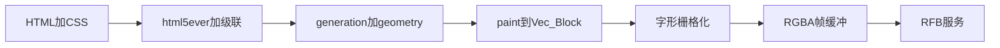

# htui-TransFormer：基于 htui 的 VNC 静态网页可视器

本文说明怎样把 htui 的 HTML/CSS 管线接到 VNC，做成一个静态网页可视器。引擎和可视器分成两个仓库。

| 仓库 | 本地目录 | 放什么 |
| --- | --- | --- |
| [jqxor/htui](https://github.com/jqxor/htui.git) | `E:\code\htui\htui-fork` | fork。htui 的改动只提交到这里。`origin` 是 fork，`upstream` 是 [dDostalker/htui](https://github.com/dDostalker/htui.git) |
| [jqxor/htui-TransFormer](https://github.com/jqxor/htui-TransFormer.git) | `E:\code\htui\htui-TransFormer` | 本仓库。字符格栅格化、帧缓冲、RFB 服务 |

`E:\code\htui\htui` 是上游检出，不在这里改，也不要把它的 `origin` 改成 fork。

## 1. 结论

能转换。转换点在绘制之后，不在解析或布局之内。

htui 已经把 HTML/CSS 画成一张字符格画布 `TermLayout.layout: Vec<Block>`。每一格携带字形、前景色、背景色，以及粗体 / 斜体 / 下划线 / 删除线。终端版接下来把这张画布 diff 成 ANSI，经 crossterm 写到 stdout。VNC 版丢掉这一步，把同一张画布栅格化成像素帧缓冲，再用 RFB 推给查看器。

VNC 客户端看到的是按位图字体放大的终端页面，不是 Chrome。htui 的布局单位是行和列，fork 里的 [边界文档](https://github.com/jqxor/htui/blob/master/docs/zh-cn/边界文档.md) 明确拒绝像素级渲染、CSS 动画、`transform`、`opacity` 和完整 grid。本项目不修改这套绘制模型去“看起来像浏览器”。

可视器缺的公开入口可以改 fork，例如不碰 tty 的无头绘制函数。RFB、位图字体和套接字留在本仓库，不进 htui。



`parse` 到 `paint` 在 fork 里。`raster` 之后在本仓库。

## 2. 复用什么，丢掉什么

### 2.1 原样复用

| 阶段 | htui 入口 | 静态可视器怎么用 |
| --- | --- | --- |
| 资源 | `Session::with_registry` | `` / `<link>` 只读会话内的 `mem://` 注册表 |
| HTML | `html::html_parse::Parser` | `parse()` 得到 `(root_id, arena, embedded_css)` |
| CSS | `html::css_parse::Parser` + `css_into_node` | 文档内 CSS 与调用方追加的会话 CSS 拼接后级联；无 `:hover` / `:focus` |
| 画布 | `TermLayout::new` + `TermLayout::draw` | 得到已定位并绘制好的 `Vec<Block>` |

集成测试里的无头顺序就是这条路径（见 fork 的 `crates/htui/tests/layout_tree_tests.rs` 的 `setup`）：解析、级联、`TermMap { columns, rows }`、`TermLayout::new(&map, zoom)`、`draw`。静态可视器照抄，不调用 `Session::render`。

`Session::render` 会进入 `tui::run::run`，占用真实终端并启动输入循环。`Config.events = false` 也只是少开脚本线程和命中线程，输出仍然是 ANSI。VNC 进程不能走这条入口。若这条无头顺序在库外拼起来太脆，就在 fork 里加一个公开函数，把「注册表 + HTML + CSS + 列行」收成一次 `draw`，返回 `TermLayout`。该函数仍不打开终端、不启动脚本线程。

`TermMap::get_ter_map()` 读的是本机 tty。无头服务自己构造 `TermMap`，列数和行数来自帧缓冲除以单元格像素，并夹在 htui 已有上限内：`MAX_TERM_COLS = 1000`，`MAX_TERM_ROWS = 500`。

### 2.2 丢掉

- `TermLayout::render` / `render_to_bytes` / `render_diff_to_bytes`：ANSI、`MoveTo`、SGR。可视器直接读 `layout`。
- 脚本线程、Boa、宿主函数、`ScriptMsg`。
- 命中测试线程、`HitMap`、hover 状态机。
- 输入循环里的焦点、拖选、表单编辑、下拉框、页面级快捷键。
- 解析结果里的 `scripts`。`<script>` 与 `on*` 留在 DOM 里，但不执行。

`parse()` 已经把脚本源拆出来。静态路径使用三元组返回值，直接忽略脚本字符串。

### 2.3 每个格子里有什么

`Block`（fork 的 `crates/htui/src/graphics/cell.rs`）：

- `word`：这一格要画的字形。普通空格是 `" "`。宽字符的第二格是空串，栅格化时跳过，避免盖住前一格。
- `fcolor` / `bcolor`：`crossterm::style::Color`，可能是命名色、256 色或 `Rgb { r, g, b }`。缺省表示终端默认色，VNC 侧映射成固定的前景 / 背景（建议深色背景、浅色前景，整帧统一）。
- `style`：`FontStyle` 位标记。第一版位图字体可以只实现粗体（重复描一遍或换粗体页）和下划线 / 删除线（在格内画线）。斜体没有独立位图时退化为正体，并在日志里记一次，不中断画面。

图片已经在 htui 里变成字符格，不需要 VNC 侧再解码。`` 使用上半块 `U+2580`：前景色是上像素，背景色是下像素，源图分辨率是每列 1 像素、每行 2 像素（`IMAGE_PIXELS_PER_CELL_COL/ROW`）。栅格化器按字形画这个半块，上半格填前景、下半格填背景。这样和终端观感一致。不要把原始图片贴回帧缓冲，那会偏离字符格语义。

### 2.4 fork 里允许改什么

只为了让本仓库能稳定调用，不把 VNC 做进引擎。

- 可以加公开的无头入口，把现有 `Parser`、`css_into_node`、`TermLayout::draw` 包成一次调用。
- 可以导出可视器需要、但目前难从库外拿到的只读数据，例如默认色语义。不改 `Block` 的字段含义。
- 保持 `html → tdom → layout → tui`。不把 RFB、字体栅格、监听套接字放进 fork。
- 改动从 `htui-fork` 推到 `origin`（`jqxor/htui`）。不推 `upstream`。
- 同步上游用 `git fetch upstream` 后合并 `upstream/master`，再推 `origin`。

## 3. 进程与 crate

本仓库是独立 crate，不加入 htui workspace。依赖 fork，不依赖上游检出：

```toml
[dependencies]
htui = { git = "https://github.com/jqxor/htui.git", branch = "master" }
```

本地联调可以暂时改成 path 依赖 `../htui-fork/crates/htui`。提交到本仓库时改回上面的 git 依赖，这样克隆本仓库的人不需要旁边再放一份 fork 源码。fork 自己还依赖旁边的 `htui-macros`，git 依赖会顺着 fork 仓库解析。静态路径不调用 `#[htui::command]`。

进程内只有两条职责：

1. **排版**：注册 `mem://`、解析、级联、`draw`，得到 `TermLayout`。
2. **RFB 线程**：持有当前帧缓冲，完成握手，响应 `FramebufferUpdateRequest` 和 `PointerEvent`。

静态文档没有脚本，不需要 htui 那四条线程。文档源在进程启动时读入内存（命令行给出的 HTML 字符串，或由宿主事先放进内存的字节）。读文件发生在可视器进程自己的启动代码里，不经过 htui 资源层。页面里的 `` / `<link href>` 仍然只能解析 `mem://`，由启动代码在 `with_registry` 里 `register`。不替页面访问磁盘或网络。

## 4. 视口

VNC 帧缓冲的像素尺寸由服务端宣布，不是由 CSS 决定。第一版用命令行给出，例如 `--width 1280 --height 720`，再向下对齐到单元格：

- 单元格固定为 **8×16** 像素，内嵌位图字体（覆盖 ASCII、常用中日韩按需加页、框线字符、`U+2580`）。
- `columns = min(width / 8, MAX_TERM_COLS)`
- `rows = min(height / 16, MAX_TERM_ROWS)`
- 帧缓冲实际像素为 `columns * 8` 乘 `rows * 16`。余数像素裁掉，避免半格。
- `TermLayout::new(&map, 1.0)`。第一版 `zoom` 固定为 1。

htui 的 `zoom` 是字符格缩放：`effective_columns = columns / zoom`，不是 CSS 的 `px`。以后若要放大，仍然先减少逻辑列数，再让每个逻辑格占 `zoom` 倍像素。不要把 `font-size: 16px` 解释成 16 个帧缓冲像素。htui 里的长度在进入布局之前已经折算成行和列。

文档可以高于视口。`draw` 会把画布撑到内容高度（`ensure_capacity`），`scroll_y` 决定视口从哪一行开始取样。帧缓冲只保留视口那么高，不把整页文档做成一张巨大的 VNC 屏幕。

经典 RFB 由服务端决定桌面尺寸，查看器把窗口拉大不会自动改服务端缓冲。窗口自适应留到第 3 阶段，并且只对声明了 `ExtendedDesktopSize`（伪编码 -308）的客户端生效。不支持该扩展的查看器保持启动时的尺寸。

## 5. 栅格化

视口内每个非空 `Block` 画进 `columns * rows` 个单元格：

1. 取视口切片。起点是 `scroll_y * columns`，长度是 `rows * columns`，并按 `layout.len()` 夹紧。这与 `render_to_bytes` 的滚动窗口一致。
2. `word` 为空：跳过（宽字符的右半格）。
3. `word == " "` 且没有背景色、没有样式：填默认背景。
4. 否则：整格先填背景，再按位图把字形以前景色写上。下划线画在格底上一行像素，删除线画在格的垂直中线。
5. 颜色：`Color::Rgb` 直接用；命名色和 `AnsiValue` 用一张固定的 xterm 256 色表；`Reset` 与 `None` 用默认前景或背景。

帧缓冲格式：每像素 4 字节，`R, G, B, A=255`，行优先，从上到下。服务端内部可以保留这份缓冲；RFB 线格式在 `ServerInit` 里宣布为 32 位真彩色、深度 24、`bits-per-pixel = 32`，并按客户端 `SetPixelFormat` 重排（很多查看器会改成 BGRA）。第一版可以在收到 `SetPixelFormat` 之前先按自己宣布的格式发，收到之后按客户端格式编码。

脏区域：静态首帧是整屏。之后只有滚动或重排才产生新帧。滚动且文档没有 `position: fixed` / `sticky` 时，画布不用重算，只按新的 `scroll_y` 重栅格化视口。`fixed` / `sticky` 在 `layout_only` 里按当前 `scroll_y` 重新钉住，这种文档每次滚动都要再 `draw` 一次。第一版可以一律重 `draw`，实现简单；视口重取样是优化，不是协议要求。

图片半块和普通字形走同一条路径。8×16 的格子会把「1 列 × 2 像素」的源图放大，画面是块状的，这是字符格模型的结果。

## 6. RFB 服务

自写最小 RFB 3.8 服务端，纯 Rust，不链接 `libvncserver`，不引入 `unsafe`。静态可视器只用到下面这些消息。

监听 `127.0.0.1:5900`（端口可用参数覆盖）。一次只服务一个客户端。第二个连接在第一个断开前拒绝。

### 6.1 握手

1. 服务端发送 `RFB 003.008\n`。
2. 客户端回版本字符串。只接受 3.8。
3. 安全类型：一种，`SecurityType = 1`（None）。不提供 VNC 密码认证。绑定地址默认是本机回环；若参数把地址改成非回环，进程拒绝启动，避免无认证暴露到网络。
4. `SecurityResult = 0`。
5. 读取 `ClientInit` 的 shared-flag，忽略其值（只有一个客户端）。
6. `ServerInit`：宽、高、像素格式、桌面名 `htui-TransFormer`。

### 6.2 只处理的客户端消息

| 消息 | 编号 | 行为 |
| --- | --- | --- |
| SetPixelFormat | 0 | 记下客户端要的通道顺序和位移，之后的矩形按这个格式编码 |
| SetEncodings | 2 | 记录客户端列表。服务端只发 Raw（编码 0）。看到 `ExtendedDesktopSize`（-308）时记住「这个客户端会请求改尺寸」 |
| FramebufferUpdateRequest | 3 | `incremental = 0` 或缓冲已脏：发一帧 Raw 矩形。增量且未脏：不发 |
| PointerEvent | 5 | 只解释滚轮，见第 7 节。坐标不命中 DOM |
| KeyEvent | 4 | 丢弃 |
| ClientCutText | 6 | 丢弃 |

### 6.3 FramebufferUpdate

一个矩形盖住整个视口，编码 Raw：按客户端像素格式逐像素写出，不压缩。视口大约 160×45 格、8×16 像素时，一帧约 1280×720×4 ≈ 3.5 MB。静态页面只在首帧、滚动和重排时发送，这个体积可接受。不实现 ZRLE、Tight、光标伪编码。

## 7. 滚动仍是静态查看

文档高于视口时，`PointerEvent` 的按钮掩码使用常见约定：bit 3（值 8）为滚轮上，bit 4（值 16）为滚轮下。一次事件把 `scroll_y` 加减 3 行，再夹到 `TermLayout::max_scroll()`。然后标记帧缓冲为脏，等下一次 `FramebufferUpdateRequest` 再推。

不把指针按下翻译成 click，不移动焦点，不打开 `<select>`，不拖选文字。键盘消息丢弃，因此不能用方向键滚动；查看器的滚轮是唯一的滚动输入。

## 8. 明确不做

- 像素级 CSS、媒体查询、动画、过渡、`transform`、`opacity`、把页面重排成「像浏览器」。
- 执行 JavaScript、`on*`、hover 高亮、表单编辑。
- 多标签、多文档、窗口管理。
- 把 VNC 键盘送进 DOM，或把点击送进命中测试。
- 替页面读磁盘、访问网络。资源仍然只来自调用方注册的 `mem://`。
- 在 fork 里改字符格绘制模型，或把 RFB 放进 htui。
- 把引擎改动推到 `dDostalker/htui`。
- 认证、加密、多客户端、剪贴板同步、光标形状。

## 9. 落地阶段

### 阶段 1：无头帧

命令行接收一段 HTML（和可选的额外 CSS）。走第 2 节的无头顺序，把视口栅格化成一张 PPM 或 PNG。用一张包含标题、段落、表格、颜色和一张 `mem://` 图片的页面，对照 `TermLayout.layout` 里的字形，确认行列、换行和半块图片没有错位。此阶段没有套接字。若库外调用确实缺入口，先在 fork 补无头函数并推到 `jqxor/htui`，本仓库再依赖那个提交。

### 阶段 2：RFB Raw

同一张帧缓冲经第 6 节的服务端发出。用系统里任意 VNC 查看器连接 `127.0.0.1:5900`，应看到与阶段 1 相同的画面。断开后进程继续等待下一次连接，避免查看器闪断就丢掉进程。

### 阶段 3：重排与滚动

- 滚轮改变 `scroll_y`，只重推视口。含 `fixed` / `sticky` 的文档改为再 `draw` 一次。
- 客户端若在 `SetEncodings` 里列出 `ExtendedDesktopSize`，并随后发来桌面尺寸请求，则按第 4 节重新计算列数和行数，再 `draw`，再发一帧。不支持该扩展的查看器保持启动尺寸。

## 10. 验收

- 引擎改动只出现在 `jqxor/htui`。本仓库没有 htui 源码副本。
- 阶段 1 的图片不依赖真实终端，测试只比较内存里的像素或 `Block`。
- 一段没有脚本的 HTML，在 80×24 逻辑格下的 `Block` 序列与 htui 现有布局测试使用同一 `draw` 路径，因此已有的字符级结果就是回归基准。
- VNC 查看器里能看到文本、背景色和半块图片；滚轮只移动视口；键盘不改变文档。
